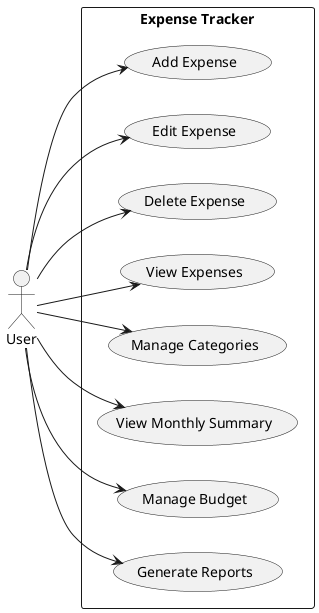
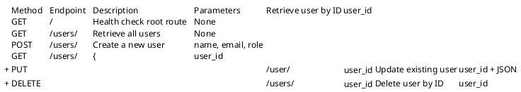

# FastAPI User Management API

A robust, lightweight RESTful API built with **FastAPI**, **SQLAlchemy**, and **SQLite**, designed for managing user records with full CRUD (Create, Read, Update, Delete) capabilities and automatic schema validation via Pydantic.

## 📺 Acknowledgments & Tutorial

This implementation was built following the fantastic step-by-step walkthrough:

* **YouTube Tutorial:** [Integration with SQL - Code with Josh](https://www.youtube.com/watch?v=xq1Snezb1rs)

## 🚀 Tech Stack

* **Framework:** [FastAPI](https://fastapi.tiangolo.com/)

* **Database & ORM:** SQLite with SQLAlchemy (Synchronous session management)

* **Data Validation:** Pydantic v2

* **Server:** Uvicorn

## 🛠️ Project Structure

```
user-management-api/
├── main.py           # FastAPI application entry point, models, schemas, and routes
├── users.db          # Local SQLite database file (auto-generated)
└── requirements.txt  # Project dependencies

```

## ⚙️ Getting Started & Installation

### 1. Create and Activate a Virtual Environment

* **On Windows:**

  ```
  python -m venv venv
  venv\Scripts\activate
  
  ```

* **On macOS / Linux:**

  ```
  python3 -m venv venv
  source venv/bin/activate
  
  ```

### 2. Install Dependencies

Install the required packages using `pip`:

```
pip install fastapi uvicorn sqlalchemy pydantic

```

### 3. Run the Application

Start the development server with live reload enabled using Uvicorn:



## 📚 API Documentation & Endpoints

Once the server is running, you can access the interactive Swagger UI and documentation directly in your browser:

* **Swagger UI:** <http://127.0.0.1:8000/docs>

* **ReDoc:** <http://127.0.0.1:8000/redoc>

### Core Endpoints Reference


## 💡 Key Features

* **Automatic Database Table Creation:** Uses SQLAlchemy metadata to automatically provision the `users` table on startup.

* **Session Management Dependency:** Implements FastAPI's `Depends` injection pattern to cleanly open and close database sessions per request lifecycle.

* **Input Validation & Serialization:** Validates incoming payloads using Pydantic models and serializes database outputs safely via `model_config = {"from_attributes": True}`.