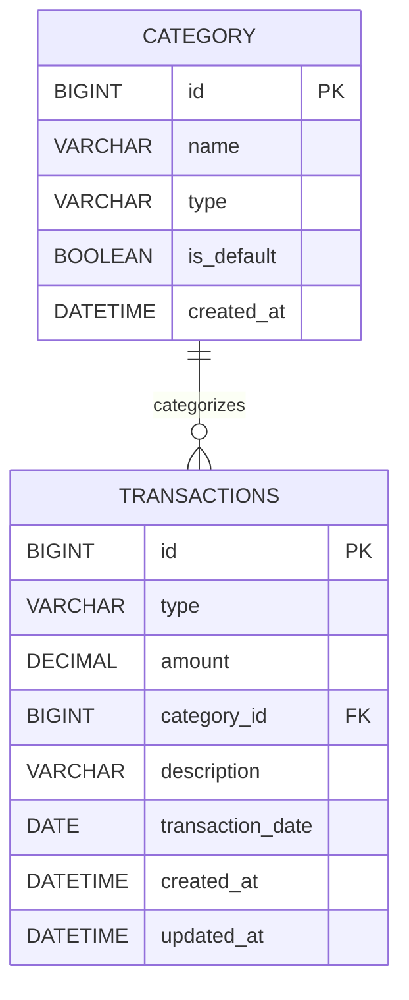

# Entity Relationship Diagram

## Purpose

This diagram represents the database structure of the Java-based Expense Tracker application, including entities, attributes, primary keys, foreign keys, and relationships.

## Diagram

## Entities

### 1. Category

Stores predefined and user-created transaction categories.

| Attribute | Description |
|---|---|
| id | Primary key |
| name | Category name |
| type | INCOME or EXPENSE |
| is_default | Indicates whether the category is predefined |
| created_at | Category creation timestamp |

### 2. Transaction

Stores income and expense records.

| Attribute | Description |
|---|---|
| id | Primary key |
| type | INCOME or EXPENSE |
| amount | Transaction amount in INR |
| category_id | Foreign key referencing Category |
| description | Transaction description |
| transaction_date | Date of the transaction |
| created_at | Record creation timestamp |
| updated_at | Last modification timestamp |

## Relationships

- One category can be associated with zero or multiple transactions.
- Each transaction belongs to exactly one category.
- A transaction's type must match its associated category's type.

## Database Constraints

- `id` uniquely identifies each record.
- `category_id` references `CATEGORY.id`.
- Transaction amounts must be positive.
- Category type and transaction type must match.
- Categories associated with transactions should not be deleted.
